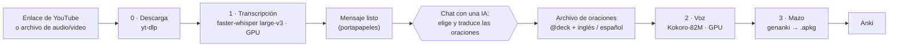

# Anki Immersion Pipeline

**Convierte videos, audios o textos en inglés en mazos de Anki con voz natural, todo en local y acelerado por tu GPU.**


> *English summary:* a local, GPU-accelerated pipeline that turns English videos or audio into Anki flashcard decks.
> YouTube link or audio file → Whisper large-v3 transcript → sentences chosen and translated by an AI chat (from a ready-made prompt) →
> natural Kokoro-82M voice → `.apkg` with deterministic IDs, so every import merges into the same deck with no duplicates.
> No paid APIs. The documentation is written in Spanish.

---

## ¿Qué es?

Aprender inglés con tarjetas de Anki funciona muy bien cuando cada tarjeta es una **oración real con audio natural**, sacada de lo que tú mismo escuchas (videos, clases, podcasts). El problema es el trabajo manual: transcribir, elegir oraciones, traducirlas, generar la voz y armar el mazo puede tomar **horas al día**.

Este proyecto automatiza la parte mecánica:

1. Descarga el audio de un video (o usa un archivo tuyo).
2. Lo **transcribe** con Whisper large-v3 en tu GPU.
3. Te deja listo un **mensaje para una IA de chat**, que elige y traduce las oraciones más útiles.
4. Genera la **voz** de cada oración con Kokoro-82M.
5. Arma el **mazo `.apkg`** para importar en Anki.

La elección de las oraciones la hace una IA de chat (Claude, DeepSeek u otra) con el mensaje que arma el proyecto. Es una decisión de diseño: así no dependes de una API de pago, y tú revisas las oraciones antes de que se conviertan en tarjetas.

## ¿Para qué sirve?

- Estudiar inglés por **inmersión**: conviertes en tarjetas el contenido que de verdad ves o escuchas.
- Tener **un mazo por fuente** (por ejemplo, uno para tu clase y uno por cada canal que sigues).
- Agregar **vocabulario nuevo** a las oraciones de un video: mencionas una palabra que no conoces y la IA la integra en oraciones del mismo video.
- Importar lotes nuevos cada día sin miedo a **duplicar tarjetas** ni a perder las que ya tienes.

## Cómo funciona



Cada etapa es un **script independiente** que carga su modelo, trabaja y termina, así la memoria de la GPU (VRAM) queda libre entre una etapa y otra. Se comunican solo mediante archivos dentro de `data/`.

## Características

- **Transcripción rápida y precisa:** faster-whisper con el modelo `large-v3` en `float16`. Medido en una RTX 4060 (8 GB): pico de **4.85 GB de VRAM** y hasta **~33x tiempo real**.
- **Voz natural y estable:** Kokoro-82M con una mezcla de dos voces; la misma oración produce siempre el mismo audio.
- **Importaciones sin duplicados:** los IDs del mazo, del tipo de nota y de cada tarjeta son **deterministas**. Importar el mismo lote dos veces no duplica, y un lote nuevo se suma al mismo mazo.
- **Varios mazos:** un registro de alias (`aula`, `blogs`, `podcast`) y una línea `@deck:` en el archivo de oraciones deciden a qué mazo va cada lote.
- **Un comando por camino:** `transcribir` (antes del chat) y `armar` (después del chat).
- **Errores claros:** el lector de oraciones reporta **todos** los problemas de un archivo de una vez, con el número de línea.
- **Pruebas automáticas:** 27 pruebas que no necesitan GPU.
- **OCR opcional** (EasyOCR) para sacar texto de fotos.

## Requisitos

| Qué | Detalle |
| --- | --- |
| Sistema | Windows (desarrollado y probado ahí). En Linux no se ha probado. |
| GPU | NVIDIA con **8 GB de VRAM** o más (probado en RTX 4060). Whisper large-v3 usa ~4.9 GB de pico. |
| Driver | NVIDIA **560 o superior** (necesario para CUDA 12.6). Se comprueba con `nvidia-smi`. |
| Python | **3.12** (lo instala `uv` solo; no hace falta tenerlo). No usar 3.13 ni 3.14. |
| Herramientas | [Git](https://git-scm.com/) y [uv](https://docs.astral.sh/uv/) |
| Para importar | [Anki](https://apps.ankiweb.net/) de escritorio |
| Disco | Varios GB: PyTorch con CUDA, el modelo Whisper large-v3 (~3 GB) y Kokoro (~330 MB) |
| Internet | Solo para instalar y para descargar los modelos la primera vez (y para descargar videos) |

## Instalación

Clona el repositorio en una carpeta **fuera de OneDrive** (PyTorch pesa varios GB y OneDrive intentaría sincronizarlo).

```powershell
# 1) Instalar uv (si no lo tienes) y abrir una terminal nueva
winget install --id=astral-sh.uv -e

# 2) Clonar y entrar a la carpeta
git clone https://github.com/AbiezerPeguero/anki-immersion-pipeline.git
cd anki-immersion-pipeline

# 3) Crear el entorno e instalar todo (descarga varios GB; usa Python 3.12 y PyTorch CUDA 12.6)
uv sync

# 4) Verificar que Python ve tu GPU y que las librerías funcionan
uv run python scripts/check_env.py
uv run python scripts/check_env.py --full    # prueba real de Whisper y Kokoro (descarga modelos pequeños)
```

Todas las líneas deben salir `[ OK ]`. Si algo falla, el mensaje dice qué revisar; la [documentación técnica](docs/DOCUMENTACION.md#13-manejo-de-errores-y-diagnóstico) tiene la tabla de errores comunes.

## Uso rápido

**1. Transcribir** (descarga el audio, lo transcribe y copia el mensaje para la IA al portapapeles):

```powershell
uv run python scripts/run.py transcribir "https://www.youtube.com/watch?v=XXXXXXXXXXX" --deck aula --n 10
```

También acepta un archivo local: `... transcribir "data\input\clase.mp4" --deck aula --n 10`.

**2. Pasar por la IA.** Pega el mensaje en un chat (Ctrl+V). Te devuelve un bloque con las oraciones; guárdalo como `data/input/mi_lote.txt`. El formato es este (hay un ejemplo en [`examples/ejemplo_oraciones.txt`](examples/ejemplo_oraciones.txt)):

```text
@deck: aula
I get lots of newspapers delivered to my house. | Me entregan muchos periódicos en mi casa.
That fee has gone up dramatically. | Esa tarifa ha subido muchísimo.
```

**3. Armar el mazo** (genera los audios y el `.apkg`):

```powershell
uv run python scripts/run.py armar data/input/mi_lote.txt
```

El resultado queda en `data/decks/aula__mi_lote.apkg`. Haz doble clic para importarlo en Anki: las tarjetas se **suman** al mazo existente y las que ya estaban no se duplican.

**Mazos.** Los alias `aula`, `blogs` y `podcast` vienen definidos en [`src/anki_pipeline/config.py`](src/anki_pipeline/config.py) (`DECKS`) con los nombres del autor. Cámbialos por los tuyos **antes de la primera importación**: el nombre del mazo determina su identidad en Anki.

**Palabras nuevas (opcional).** Si escribes al final del mensaje una línea como `Palabras: hefty, waive, hang out`, la IA incluye esas palabras en oraciones del video (añadiendo hasta 3 palabras más para que suenen naturales). Sin esa línea, todas las oraciones son fieles al video.

## Cómo se ve una tarjeta

| | |
| --- | --- |
| **Frente** | La oración en inglés + el audio con la voz natural |
| **Reverso** | La traducción al español |

## Estructura del proyecto

```text
anki-immersion-pipeline/
├── src/anki_pipeline/     núcleo reutilizable (transcripción, voz, mazos, OCR, descarga, prompt)
├── scripts/               los comandos: run.py (lanzador), 00_download … 03_build_deck, check_env, etc.
├── prompts/               plantilla del mensaje para la IA
├── examples/              archivo de oraciones de ejemplo
├── tests/                 27 pruebas automáticas (no necesitan GPU)
├── docs/                  documentación técnica y guía de uso diario
├── vendor/                modelo de spaCy incluido localmente (lo necesita Kokoro)
├── data/                  entradas y salidas (ignorado por git)
└── pyproject.toml, uv.lock   dependencias y versiones exactas
```

## Tecnologías

| Área | Herramienta |
| --- | --- |
| Entorno y dependencias | `uv`, `pyproject.toml`, `uv.lock` |
| Transcripción | `faster-whisper` (CTranslate2) con Whisper `large-v3` |
| Voz (TTS) | Kokoro-82M (`kokoro`, `espeak-ng`, `spaCy`) |
| Mazos de Anki | `genanki` |
| Descarga de audio | `yt-dlp` + Deno + ffmpeg empaquetado (`imageio-ffmpeg`) |
| OCR (opcional) | EasyOCR + OpenCV |
| Deep learning | PyTorch `+cu126` |
| Pruebas | `pytest` |

## Pruebas

Las pruebas no necesitan GPU ni modelos descargados:

```powershell
uv run python -m pytest -q
```

## Decisiones de diseño destacadas

- **Etapas en procesos separados**, para que la VRAM se libere entre etapas y un fallo no tumbe a las demás.
- **Identidad determinista en Anki** (IDs derivados de nombres y oraciones) para que las importaciones se sumen sin duplicar.
- **Python 3.12 fijado y topes de versión** en `pyproject.toml`, para evitar choques con librerías recién publicadas.
- **PyTorch CUDA 12.6** porque el motor de Whisper (CTranslate2) necesita CUDA 12.
- **Medir antes de decidir:** los parámetros de Whisper y del OCR se eligieron con scripts de medición incluidos (`probe_whisper_vram.py`, `compare_ocr.py`, `compare_voices.py`).

El detalle y las alternativas descartadas están en la [documentación técnica](docs/DOCUMENTACION.md#15-decisiones-de-diseño).

## Limitaciones

- Pensado para **Windows con GPU NVIDIA**; no hay modo sin GPU para Whisper en este proyecto.
- Configurado para **inglés** (`WHISPER_LANGUAGE`, `KOKORO_LANG`).
- La **selección de oraciones depende de una IA externa** y se hace con copiar y pegar; hay que revisar su resultado.
- El **OCR** es opcional y menos fiable que copiar el texto directamente (por ejemplo con Google Lens).
- Solo se ejecuta **una etapa de GPU a la vez**, por diseño.

## Aviso de uso

Descargar videos de YouTube va contra sus condiciones de servicio. Usa esta herramienta únicamente con material que puedas ver legalmente y para tu estudio personal, y respeta los derechos de autor del contenido. Los modelos y librerías tienen sus propias licencias (ver la [documentación técnica](docs/DOCUMENTACION.md#16-seguridad-privacidad-y-licencias)).

## Licencia

Código distribuido bajo la licencia [MIT](LICENSE). Los modelos y las librerías de terceros conservan sus propias licencias (ver la [documentación técnica](docs/DOCUMENTACION.md#16-seguridad-privacidad-y-licencias)).

## Autor

Abiezer · GitHub: [@AbiezerPeguero](https://github.com/AbiezerPeguero)

---

## Documentación

- **[Documentación técnica completa](docs/DOCUMENTACION.md)**: arquitectura, formatos de archivo, referencia de módulos y de la línea de comandos, configuración, identidad de Anki, rendimiento, pruebas, decisiones de diseño y solución de problemas.
- **[Guía personal de uso diario](docs/GUIA_PERSONAL.md)**: comandos paso a paso de la rutina del autor, uno por mazo, desde abrir el proyecto hasta importar en Anki.
