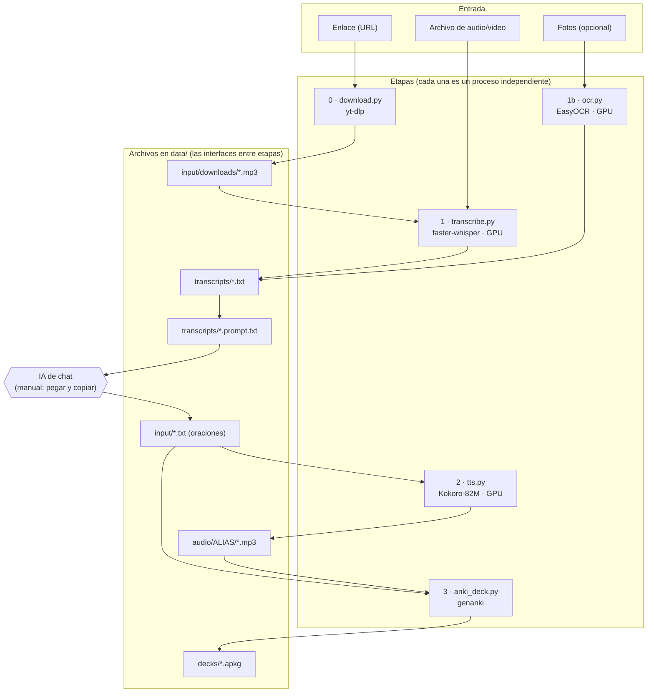
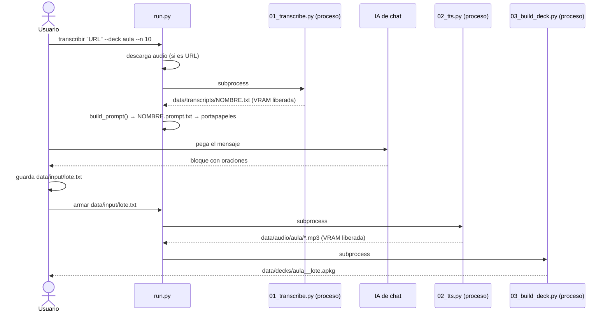

# Documentación técnica — Anki Immersion Pipeline

> Versión del paquete: `0.1.0` · Idioma de la documentación: español
> Presentación del proyecto: [`README.md`](../README.md) · Rutina de uso diario del autor: [`GUIA_PERSONAL.md`](GUIA_PERSONAL.md)

## Contenido

1. [Introducción y alcance](#1-introducción-y-alcance)
2. [Arquitectura](#2-arquitectura)
3. [Requisitos y compatibilidad](#3-requisitos-y-compatibilidad)
4. [Instalación y verificación](#4-instalación-y-verificación)
5. [Estructura del repositorio](#5-estructura-del-repositorio)
6. [Flujo de datos y contratos de archivos](#6-flujo-de-datos-y-contratos-de-archivos)
7. [Referencia de módulos](#7-referencia-de-módulos)
8. [Referencia de la línea de comandos](#8-referencia-de-la-línea-de-comandos)
9. [Configuración](#9-configuración)
10. [Identidad estable en Anki](#10-identidad-estable-en-anki)
11. [GPU y rendimiento](#11-gpu-y-rendimiento)
12. [Generación de oraciones con una IA (prompt)](#12-generación-de-oraciones-con-una-ia-prompt)
13. [Manejo de errores y diagnóstico](#13-manejo-de-errores-y-diagnóstico)
14. [Pruebas](#14-pruebas)
15. [Decisiones de diseño](#15-decisiones-de-diseño)
16. [Seguridad, privacidad y licencias](#16-seguridad-privacidad-y-licencias)
17. [Limitaciones conocidas](#17-limitaciones-conocidas)
18. [Cómo extender el proyecto](#18-cómo-extender-el-proyecto)
19. [Mantenimiento](#19-mantenimiento)
20. [Glosario](#20-glosario)

---

## 1. Introducción y alcance

**Propósito.** Convertir material en inglés (videos, audios, textos) en un mazo de Anki cuyas tarjetas son oraciones con audio generado por una voz neuronal, listo para importar. Todo el procesamiento pesado (transcripción y voz) corre **localmente** en una GPU NVIDIA.

**Qué hace el proyecto**

- Descarga el audio de un enlace (yt-dlp) o usa un archivo local.
- Transcribe el audio con faster-whisper (`large-v3`).
- Arma un mensaje (prompt) que se pega en una IA de chat para que elija y traduzca oraciones.
- Lee el archivo de oraciones que devuelve la IA, genera un `.mp3` por oración con Kokoro-82M y construye un `.apkg` con genanki.
- Garantiza que las importaciones sucesivas se sumen al mismo mazo sin duplicar tarjetas (identidad determinista).
- Opcionalmente, extrae texto de fotos con OCR.

**Qué no hace**

- **No elige las oraciones por sí mismo:** esa decisión la toma una IA de chat externa y la revisa la persona (ver [sección 12](#12-generación-de-oraciones-con-una-ia-prompt)).
- No sincroniza con AnkiWeb ni con la aplicación de Anki; entrega un archivo `.apkg`.
- No traduce ni corrige oraciones por su cuenta.
- No ofrece interfaz gráfica: se usa por línea de comandos.

---

## 2. Arquitectura

### 2.1 Vista general



### 2.2 Principios de diseño

| Principio                          | Cómo se aplica                                                                                                       | Para qué                                                                                           |
| ---------------------------------- | -------------------------------------------------------------------------------------------------------------------- | -------------------------------------------------------------------------------------------------- |
| **Una etapa = un proceso**         | Cada script carga su modelo, trabaja y termina; el lanzador (`run.py`) las encadena con `subprocess`.                | Al terminar el proceso, el sistema libera toda la VRAM; ninguna etapa compite con otra por la GPU. |
| **Archivos como interfaces**       | Las etapas solo se comunican por archivos de `data/` (texto, `.mp3`, `.apkg`).                                       | Se puede repetir o depurar una etapa por separado, y los resultados son revisables a mano.         |
| **Núcleo reutilizable + CLI fina** | La lógica vive en `src/anki_pipeline/`; los scripts de `scripts/` solo leen argumentos, llaman al núcleo e imprimen. | Reutilizar el código desde otros programas o pruebas sin pasar por la línea de comandos.           |
| **Imports pesados perezosos**      | `torch`, `faster_whisper`, `kokoro`, `genanki`, `cv2` se importan dentro de las funciones que los usan.              | Las pruebas y las validaciones corren sin GPU ni modelos.                                          |
| **Identidad determinista**         | IDs de mazo, modelo, tarjeta y audio se derivan con SHA-1 de nombres y textos.                                       | Importar de nuevo no duplica; los resultados son reproducibles.                                    |
| **Fallar con mensajes útiles**     | Los lectores validan y reportan **todos** los errores de una vez, con número de línea y qué hacer.                   | Corregir un archivo en una sola pasada.                                                            |

### 2.3 Etapas

| Etapa | Script               | Módulo          | Entrada              | Salida                                              | ¿Usa GPU?     |
| ----- | -------------------- | --------------- | -------------------- | --------------------------------------------------- | ------------- |
| 0     | `00_download.py`     | `download.py`   | URL                  | `data/input/downloads/<título>_<id>.mp3`            | No            |
| 1     | `01_transcribe.py`   | `transcribe.py` | audio/video          | `data/transcripts/<nombre>.txt` y `.timestamps.txt` | Sí (Whisper)  |
| 1b    | `01b_ocr.py`         | `ocr.py`        | fotos                | `data/transcripts/<nombre>.txt`                     | Sí (EasyOCR)  |
| —     | `run.py transcribir` | `prompt.py`     | URL o archivo        | etapas 0–1 + `<nombre>.prompt.txt` + portapapeles   | (vía etapa 1) |
| 2     | `02_tts.py`          | `tts.py`        | archivo de oraciones | `data/audio/<alias>/<hash>.mp3`                     | Sí (Kokoro)   |
| 3     | `03_build_deck.py`   | `anki_deck.py`  | oraciones + audios   | `data/decks/<alias>__<nombre>.apkg`                 | No            |
| —     | `run.py armar`       | —               | archivo de oraciones | etapas 2–3                                          | (vía etapa 2) |

### 2.4 Secuencia de los dos comandos principales



---

## 3. Requisitos y compatibilidad

| Componente        | Requisito                                     | Notas                                                                                                                     |
| ----------------- | --------------------------------------------- | ------------------------------------------------------------------------------------------------------------------------- |
| Sistema operativo | Windows                                       | Desarrollado y probado en Windows. En Linux no se ha probado (el ajuste de DLL de `cuda_setup.py` solo actúa en Windows). |
| GPU               | NVIDIA, **8 GB de VRAM** o más recomendados   | Probado en RTX 4060 de 8 GB (~6.9 GB libres en reposo, con Windows usando ~1 GB).                                         |
| Driver NVIDIA     | **≥ 560**                                     | Necesario para CUDA 12.6. Se verifica con `nvidia-smi`.                                                                   |
| Python            | **3.12** (`requires-python = ">=3.12,<3.13"`) | Kokoro exige `<3.13`. `uv` lo descarga solo.                                                                              |
| Gestor            | `uv`                                          | Lee `pyproject.toml` y `uv.lock` y crea el entorno `.venv`.                                                               |
| Git               | cualquier versión reciente                    | Para clonar el repositorio.                                                                                               |
| Anki              | escritorio                                    | Para importar el `.apkg`.                                                                                                 |
| Disco             | varios GB                                     | PyTorch con CUDA, Whisper large-v3 (~3 GB) y Kokoro (~330 MB).                                                            |
| Red               | solo en instalación y primera ejecución       | Descarga librerías y modelos (Hugging Face) y videos (yt-dlp).                                                            |

**Versiones relevantes** (resueltas en `uv.lock` al momento de escribir esta documentación):

| Paquete                  | Versión / rango                                                  | Por qué importa                                                |
| ------------------------ | ---------------------------------------------------------------- | -------------------------------------------------------------- |
| `torch`, `torchvision`   | `2.14.1+cu126` (índice `https://download.pytorch.org/whl/cu126`) | Build CUDA 12.6; trae cuBLAS 12 y cuDNN 9 que usa CTranslate2. |
| `ctranslate2`            | `4.8.5` (dependencia de faster-whisper)                          | Necesita CUDA 12 y cuDNN 9.                                    |
| `faster-whisper`         | `>=1.2.1`                                                        | Transcripción con `BatchedInferencePipeline`.                  |
| `kokoro`                 | `>=0.9.4`                                                        | Voz Kokoro-82M.                                                |
| `genanki`                | `>=0.13.1`                                                       | Generación de `.apkg`.                                         |
| `av`                     | `>=14,<17`                                                       | Tope de versión (restricción en `[tool.uv]`).                  |
| `opencv-python-headless` | `>=4.10,<5`                                                      | Tope de versión.                                               |
| `numpy`                  | `>=2.0,<2.4`                                                     | Tope de versión.                                               |

Los topes existen porque `kokoro`, `easyocr` y `faster-whisper` declaran rangos abiertos; sin ellos, `uv` instalaría versiones recién publicadas (por ejemplo OpenCV 5.x o NumPy 2.5) que no se probaron con esas librerías.

---

## 4. Instalación y verificación

### 4.1 Pasos

```powershell
# 1) Herramientas (si faltan)
winget install --id=astral-sh.uv -e        # y abrir una terminal NUEVA para que 'uv' aparezca en el PATH
git --version                              # si falta: https://git-scm.com/

# 2) Revisar la GPU
nvidia-smi                                 # driver >= 560

# 3) Clonar FUERA de OneDrive
git clone https://github.com/AbiezerPeguero/anki-immersion-pipeline.git
cd anki-immersion-pipeline

# 4) Crear el entorno e instalar (varios GB)
uv sync

# 5) Verificar
uv run python scripts/check_env.py
uv run python scripts/check_env.py --full
```

**Qué hace `uv sync`:** lee `pyproject.toml` (qué Python y qué librerías), respeta `uv.lock` (versiones exactas), descarga Python 3.12 si hace falta (independiente del Python global) y crea la carpeta `.venv` dentro del proyecto. El modelo de spaCy `en_core_web_sm` viene en `vendor/` y se instala desde ahí, sin depender de GitHub.

**Uso con o sin activar el entorno.** `uv run python scripts/...` funciona siempre. Si activas el entorno (`.\.venv\Scripts\Activate.ps1`; en VS Code se activa solo con la configuración incluida en `.vscode/settings.json`), puedes escribir `python scripts/...` sin `uv run`.

### 4.2 Qué comprueba `check_env.py`

| Sección       | Comprobación                                                                                                                                              |
| ------------- | --------------------------------------------------------------------------------------------------------------------------------------------------------- |
| Python        | Versión 3.12 (avisa con `[WARN]` si es otra).                                                                                                             |
| PyTorch + GPU | Que sea una build CUDA (`+cu126`), que `torch.cuda.is_available()` sea verdadero, nombre y VRAM de la GPU, y una multiplicación de matrices real en fp16. |
| CTranslate2   | Que vea la GPU y soporte `float16`.                                                                                                                       |
| Librerías     | `import` de `faster_whisper`, `kokoro`, `soundfile`, `genanki`, `easyocr`, `yt_dlp`, `spacy`, `espeakng_loader`, y el ffmpeg empaquetado.                 |
| `--full`      | Prueba real de Whisper (`tiny`) y de Kokoro en la GPU (descarga modelos pequeños). Genera `data/tmp/check_kokoro.wav` para escuchar la voz.               |

Cada línea sale como `[ OK ]`, `[WARN]` o `[FAIL]`. El proceso termina con código `1` si hay algún `[FAIL]`.

### 4.3 Carpetas de datos

Las carpetas de `data/` vienen con un `.gitkeep` y su contenido está ignorado por git. Cada etapa crea las subcarpetas que necesita para escribir su salida.

---

## 5. Estructura del repositorio

```text
anki-immersion-pipeline/
├── .github/workflows/tests.yml     pruebas automáticas en GitHub Actions (sin GPU)
├── .vscode/settings.json           intérprete y activación automática del entorno
├── data/                           entradas y salidas (contenido ignorado por git)
│   ├── input/                      archivos de oraciones y medios de entrada
│   │   └── downloads/              audios descargados
│   ├── transcripts/                transcripciones y mensajes para la IA
│   ├── audio/<alias>/              un .mp3 por oración, separado por mazo
│   ├── decks/                      .apkg finales
│   └── tmp/                        temporales y pruebas
├── docs/
│   ├── DOCUMENTACION.md            este documento
│   └── GUIA_PERSONAL.md            rutina diaria del autor
├── examples/ejemplo_oraciones.txt  archivo de oraciones de ejemplo
├── prompts/
│   ├── plantilla_prompt.txt        plantilla del mensaje (con marcadores)
│   └── generar_oraciones.md        versión legible del mensaje
├── scripts/                        comandos de línea de comandos
├── src/anki_pipeline/              núcleo reutilizable
├── tests/                          pruebas (pytest)
├── vendor/en_core_web_sm-3.8.0-py3-none-any.whl   modelo spaCy local
├── pyproject.toml / uv.lock        dependencias y versiones exactas
└── .python-version                 3.12
```

### 5.1 Módulos de `src/anki_pipeline/`

| Módulo          | Responsabilidad                                                            |
| --------------- | -------------------------------------------------------------------------- |
| `config.py`     | Rutas, modelos, voz, registro de mazos y constantes de Anki.               |
| `cuda_setup.py` | Hace visibles a CTranslate2 las DLL de CUDA 12 que trae PyTorch (Windows). |
| `download.py`   | Descarga el audio de una URL con yt-dlp.                                   |
| `transcribe.py` | Transcripción con faster-whisper y formato de salida.                      |
| `prompt.py`     | Arma el mensaje para la IA a partir de la plantilla.                       |
| `sentences.py`  | Lee y valida el archivo de oraciones.                                      |
| `decks.py`      | Resuelve el mazo de un archivo y la carpeta de sus audios.                 |
| `tts.py`        | Genera los audios con Kokoro y los codifica a mp3.                         |
| `anki_deck.py`  | IDs estables y construcción del `.apkg`.                                   |
| `ocr.py`        | OCR de fotos con OpenCV + EasyOCR.                                         |

---

## 6. Flujo de datos y contratos de archivos

### 6.1 Entrada de medios

Cualquier audio o video que ffmpeg/PyAV pueda leer (mp3, mp4, wav, m4a…). Las descargas de yt-dlp se guardan como `data/input/downloads/<título>_<id>.mp3` (título recortado a 80 caracteres y con nombre seguro para Windows: `--restrict-filenames`).

### 6.2 Transcripción (`data/transcripts/`)

Dos archivos por audio, ambos UTF-8:

| Archivo                   | Contenido                                                         | Ejemplo                                      |
| ------------------------- | ----------------------------------------------------------------- | -------------------------------------------- |
| `<nombre>.txt`            | Un segmento por línea, sin tiempos. Es lo que se pega en la IA.   | `Today, we're going to talk about the news.` |
| `<nombre>.timestamps.txt` | Igual, con `[MM:SS]` al inicio (`[H:MM:SS]` si pasa de una hora). | `[01:29] They come right to my doorstep.`    |

### 6.3 Mensaje para la IA

`data/transcripts/<nombre>.prompt.txt`: la plantilla `prompts/plantilla_prompt.txt` con el mazo, la cantidad de oraciones y la transcripción ya insertados. En Windows, además se copia al portapapeles.

### 6.4 Archivo de oraciones

Es la entrada de las etapas 2 y 3 y lo que devuelve la IA. UTF-8 (se tolera BOM).

```text
@deck: aula
# comentario: se ignora
I get lots of newspapers delivered to my house. | Me entregan muchos periódicos en mi casa.
That fee has gone up dramatically. | Esa tarifa ha subido muchísimo.
```

**Reglas del lector (`sentences.py` y `decks.py`)**

| Regla                 | Detalle                                                                                                                                                                                             |
| --------------------- | --------------------------------------------------------------------------------------------------------------------------------------------------------------------------------------------------- | -------------------------------------------------------------------- |
| Directiva de mazo     | Línea `@deck: alias` (sin distinguir mayúsculas; el alias se pasa a minúsculas). La primera que aparezca vale. También se puede pasar `--deck alias` por la línea de comandos, que tiene prioridad. |
| Comentarios y vacías  | Las líneas vacías y las que empiezan con `#` se ignoran. Toda línea que empiece con `@deck` se salta como oración.                                                                                  |
| Separador             | Se divide por el **primer** `                                                                                                                                                                       | `. Cada lado se normaliza (espacios repetidos y saltos se colapsan). |
| Campos vacíos         | Si el inglés o la traducción quedan vacíos, es un error.                                                                                                                                            |
| Duplicados            | Si el mismo inglés (sin distinguir mayúsculas) aparece dos veces, se conserva la primera y se emite un aviso `[WARN]`.                                                                              |
| Errores               | Se acumulan **todos** y se lanza un único `ValueError` con el número de línea de cada uno.                                                                                                          |
| Archivo sin oraciones | Error: "El archivo no contiene ninguna oración."                                                                                                                                                    |
| Alias                 | Un alias que no esté en `config.DECKS` es un **error a propósito**: evita que un error de tipeo cree un mazo nuevo sin que se note.                                                                 |

### 6.5 Audios (`data/audio/<alias>/`)

- Un `.mp3` por oración, en una carpeta por mazo.
- **Nombre:** `sha1("<inglés normalizado>|<voz>|<velocidad con 2 decimales>")[:12] + ".mp3"`. Misma oración + misma voz + misma velocidad = mismo archivo.
- **Caché:** si el archivo ya existe, no se regenera (salvo `--force`). Si todo está en caché, ni siquiera se carga el modelo.
- **Formato:** mono, 24 kHz de generación; mp3 con `libmp3lame -q:a 4`; se añaden 0.25 s de silencio al final para que Anki no corte la última sílaba.
- **Escritura atómica:** se escribe como `<nombre>.mp3.part` y se renombra al terminar, así un fallo no deja audios a medias.

### 6.6 Mazo

`data/decks/<alias>__<nombre-del-archivo-de-oraciones>.apkg`, por ejemplo `data/decks/aula__mi_lote.apkg`. Contiene solo el lote nuevo y sus audios.

---

## 7. Referencia de módulos

> Las funciones reciben rutas como `str` o `Path`. Los errores esperables se lanzan como `FileNotFoundError`, `ValueError` o `RuntimeError`, con mensaje en español.

### 7.1 `config`

Constantes y rutas; ver [sección 9](#9-configuración). Función: `ensure_dirs()` crea las carpetas de `data/`.

### 7.2 `cuda_setup`

`ensure_cuda_dlls() -> None`: en Windows, añade `torch/lib` al camino de búsqueda de DLL (`os.add_dll_directory` y `PATH`) e importa `torch` para dejar cuBLAS/cuDNN cargados. Se ejecuta una sola vez por proceso y no hace nada fuera de Windows. **Debe llamarse antes de importar `faster_whisper`.** Evita el error `Library cublas64_12.dll is not found`.

### 7.3 `download`

| Elemento                                                                                              | Descripción                                                                                                                                                                                                                                                                                                                                                                                                                                                         |
| ----------------------------------------------------------------------------------------------------- | ------------------------------------------------------------------------------------------------------------------------------------------------------------------------------------------------------------------------------------------------------------------------------------------------------------------------------------------------------------------------------------------------------------------------------------------------------------------- |
| `OUTPUT_TEMPLATE`                                                                                     | `"%(title).80s_%(id)s.%(ext)s"`                                                                                                                                                                                                                                                                                                                                                                                                                                     |
| `build_ytdlp_command(url, out_dir, ffmpeg_exe, filepath_log, python_exe=sys.executable) -> list[str]` | Construye el comando `python -m yt_dlp` con: `--no-playlist` (un enlace con lista baja solo ese video), `-x --audio-format mp3 --audio-quality 5`, `--ffmpeg-location`, `--restrict-filenames`, `-o`, y `--print-to-file after_move:filepath` (para saber dónde quedó el mp3).                                                                                                                                                                                      |
| `download_audio(url, out_dir=None) -> Path`                                                           | Valida que la URL empiece con `http://` o `https://` y que no tenga **otro enlace pegado dentro**; ejecuta yt-dlp como subproceso (sus errores no tumban el pipeline y su progreso se ve en pantalla) y devuelve la ruta del mp3. Antepone al `PATH` la carpeta del Python del entorno, para que yt-dlp encuentre el Deno empaquetado aunque el entorno no esté activado. Lanza `ValueError` (URL inválida) o `RuntimeError` (yt-dlp falló o el archivo no existe). |

### 7.4 `transcribe`

| Elemento                                                                                                            | Descripción                                                                                     |
| ------------------------------------------------------------------------------------------------------------------- | ----------------------------------------------------------------------------------------------- |
| `TranscriptResult`                                                                                                  | `text_path`, `timestamps_path`, `language`, `duration_s`, `elapsed_s`, `n_segments`, `n_words`. |
| `fmt_timestamp(seconds) -> str`                                                                                     | `"MM:SS"`, o `"H:MM:SS"` si hay horas.                                                          |
| `render_transcripts(rows) -> (texto, texto_con_tiempos)`                                                            | `rows` es una lista de `(inicio_s, fin_s, texto)`.                                              |
| `transcribe_file(audio_path, out_dir=None, *, model_name, compute_type, batch_size, beam_size, language, progress)` | Transcribe y escribe los dos archivos.                                                          |

Comportamiento de `transcribe_file`:

- Importa `faster_whisper` y llama a `ensure_cuda_dlls()` **dentro** de la función (importar el módulo no exige GPU).
- Carga `WhisperModel(model_name, device="cuda", compute_type=compute_type)`.
- Si `batch_size > 1`, usa `BatchedInferencePipeline(...).transcribe(..., batch_size=...)`; si es `1`, usa `model.transcribe(..., vad_filter=True, condition_on_previous_text=False)` (esto último evita bucles de repetición en audios largos).
- El generador de segmentos es el que realmente transcribe; `progress(fin_del_segmento, duración)` se llama en cada segmento.
- El tiempo `elapsed_s` empieza **después** de cargar el modelo.
- Lanza `FileNotFoundError` si el audio no existe.

### 7.5 `prompt`

`build_prompt(deck_key, n, text, template=None) -> str`

- Lanza `ValueError` si `n < 1` o si a la plantilla le falta alguno de los marcadores `{{DECK}}`, `{{N}}`, `{{TEXT}}`.
- Sustituye primero `{{DECK}}` y `{{N}}`, y **al final** `{{TEXT}}`, para que ningún texto de la transcripción pueda confundirse con un marcador.
- Quita los espacios sobrantes del texto. `TEMPLATE_PATH` apunta a `prompts/plantilla_prompt.txt`.

### 7.6 `sentences`

| Elemento                                                        | Descripción                                                                                                                                                    |
| --------------------------------------------------------------- | -------------------------------------------------------------------------------------------------------------------------------------------------------------- |
| `SentencePair(english, spanish, line_no)`                       | Dataclass inmutable.                                                                                                                                           |
| `normalize(text) -> str`                                        | Colapsa espacios y saltos: `"Hello   world "` → `"Hello world"`.                                                                                               |
| `parse_sentences_file(path) -> (list[SentencePair], list[str])` | Devuelve las oraciones y los avisos (duplicados). Lanza `FileNotFoundError` o `ValueError` (con todos los errores). Reglas en [6.4](#64-archivo-de-oraciones). |

### 7.7 `decks`

| Elemento                                        | Descripción                                                                                          |
| ----------------------------------------------- | ---------------------------------------------------------------------------------------------------- |
| `read_deck_directive(path) -> str \| None`      | Devuelve el alias de la primera línea `@deck:` (en minúsculas) o `None`.                             |
| `resolve_deck(key) -> (alias, nombre_del_mazo)` | Valida contra `config.DECKS`; lanza `ValueError` con la lista de alias válidos si falta o no existe. |
| `deck_audio_dir(key) -> Path`                   | `data/audio/<alias>`.                                                                                |

### 7.8 `tts`

| Elemento                                                                              | Descripción                                                                                                                                                                                                                                            |
| ------------------------------------------------------------------------------------- | ------------------------------------------------------------------------------------------------------------------------------------------------------------------------------------------------------------------------------------------------------ |
| `SAMPLE_RATE = 24000`, `TAIL_SILENCE_S = 0.25`                                        | Parámetros de audio.                                                                                                                                                                                                                                   |
| `audio_filename(english, voice, speed) -> str`                                        | Nombre determinista del audio (ver [6.5](#65-audios-dataaudioalias)).                                                                                                                                                                                  |
| `prepare_for_tts(text) -> str`                                                        | Añade un punto final si falta (la entonación de cierre de Kokoro depende de la puntuación). Solo afecta lo que se dice, no el texto de la tarjeta ni el nombre del audio.                                                                              |
| `pcm_to_mp3(samples, out_path)`                                                       | Codifica un arreglo float32 mono a mp3 con el ffmpeg empaquetado, con silencio final y escritura atómica.                                                                                                                                              |
| `KokoroSynth(voice, speed, lang)`                                                     | Carga `KPipeline(lang_code=lang, repo_id="hexgrad/Kokoro-82M")`. `synth(text)` devuelve el audio como arreglo float32; lanza `RuntimeError` si Kokoro no genera audio.                                                                                 |
| `TtsStats`                                                                            | `generated`, `cached`, `failed`, `elapsed_s`, `load_s`.                                                                                                                                                                                                |
| `synthesize_all(pairs, audio_dir=None, *, voice, speed, force, progress) -> TtsStats` | Genera los audios que falten. Carga el modelo **solo si hay algo por generar**. Un fallo en una oración se cuenta en `failed` y el proceso continúa con las demás. `progress(i, total, pair, estado)` recibe `"generada"`, `"cache"` o `"FALLO: ..."`. |

### 7.9 `anki_deck`

| Elemento                                                                                | Descripción                                                                                                                                                                         |
| --------------------------------------------------------------------------------------- | ----------------------------------------------------------------------------------------------------------------------------------------------------------------------------------- |
| `stable_id(label) -> int`                                                               | Entero reproducible en `[2³⁰, 2³¹)`. Ver [sección 10](#10-identidad-estable-en-anki).                                                                                               |
| `deck_id(deck_name)`, `model_id(model_name, version)`                                   | IDs derivados de nombres.                                                                                                                                                           |
| `note_guid_key(english) -> str`                                                         | Texto normalizado y en minúsculas (`casefold`) con el que se calcula el GUID.                                                                                                       |
| `CSS`                                                                                   | Estilo de la tarjeta, sin colores fijos.                                                                                                                                            |
| `DeckBuildResult`                                                                       | `apkg_path`, `deck_name`, `deck_id`, `n_notes`.                                                                                                                                     |
| `build_deck(pairs, out_path, *, audio_dir, voice, speed, deck_name) -> DeckBuildResult` | Verifica que existan **todos** los audios (si faltan, lanza `FileNotFoundError` con los primeros 10) y escribe el `.apkg` con el modelo de nota, las notas y los archivos de audio. |

### 7.10 `ocr`

| Elemento                                                                  | Descripción                                                                                                                       |
| ------------------------------------------------------------------------- | --------------------------------------------------------------------------------------------------------------------------------- |
| `IMAGE_EXTS`, `PREPROCESS_MODES = ("gray", "none")`, `MIN_SIDE_PX = 1600` | Formatos aceptados, modos de preprocesado y lado mínimo.                                                                          |
| `collect_images(paths) -> list[Path]`                                     | Acepta archivos y carpetas (las carpetas aportan sus imágenes en orden alfabético).                                               |
| `read_image(path)`                                                        | Lee por bytes (`imdecode`): `cv2.imread` falla con rutas con acentos en Windows.                                                  |
| `preprocess_image(img, mode="gray")`                                      | `gray`: escala de grises, ampliación a `MIN_SIDE_PX` si es más pequeña, y CLAHE. `none`: sin cambios.                             |
| `low_resolution_warning(path) -> str \| None`                             | Aviso si la foto es menor que `MIN_SIDE_PX` (las fotos comprimidas por mensajería hacen que el OCR confunda letras).              |
| `dehyphenate(text) -> str`                                                | Une palabras partidas por guion al final de línea (`conver- sation` → `conversation`), solo si lo que sigue empieza en minúscula. |
| `ocr_one(...)`, `make_reader(...)`, `ocr_images(...)`                     | Lectura de una imagen, creación del lector EasyOCR y lectura de varias.                                                           |
| `text_similarity(reference, hypothesis) -> (palabras, caracteres)`        | Similitud de 0 a 1, usada por `compare_ocr.py`.                                                                                   |
| `write_ocr_text(pages, name, out_dir=None) -> Path`                       | Escribe el `.txt` de salida.                                                                                                      |

---

## 8. Referencia de la línea de comandos

> Todos los comandos se ejecutan desde la raíz del proyecto. Anteponer `uv run` si el entorno no está activado. Los scripts devuelven `0` si todo va bien y `1` si hay un error (en `02_tts.py`, también si alguna oración falló).

### 8.1 `run.py` (lanzador)

```powershell
python scripts/run.py transcribir <enlace|archivo> --deck ALIAS [--n 10] [--no-copiar]
python scripts/run.py armar <archivo_de_oraciones.txt>
```

**`transcribir`**

| Argumento     | Descripción                                                            |
| ------------- | ---------------------------------------------------------------------- |
| `source`      | URL (debe empezar con `http://` o `https://`) o ruta a un audio/video. |
| `--deck`      | **Obligatorio.** Alias definido en `config.DECKS`.                     |
| `--n`         | Cantidad de oraciones que se pedirán a la IA. Por defecto `10`.        |
| `--no-copiar` | No copia el mensaje al portapapeles.                                   |

Pasos: valida el mazo → descarga el audio (si es URL) → ejecuta `01_transcribe.py` como proceso aparte → lee `data/transcripts/<nombre>.txt` → arma el mensaje con `build_prompt` → lo guarda como `<nombre>.prompt.txt` → lo copia al portapapeles (solo Windows, con `Set-Clipboard` de PowerShell; en otros sistemas informa dónde está el archivo).

**`armar`**: ejecuta `02_tts.py` y luego `03_build_deck.py` sobre el archivo, cada uno como proceso aparte. El mazo sale de la línea `@deck:` del archivo.

### 8.2 Etapas por separado

| Script             | Uso                                               | Opciones                                                                                             |
| ------------------ | ------------------------------------------------- | ---------------------------------------------------------------------------------------------------- |
| `00_download.py`   | `python scripts/00_download.py "<URL>"`           | `--out-dir` (por defecto `data/input/downloads`)                                                     |
| `01_transcribe.py` | `python scripts/01_transcribe.py <audio>`         | `--out-dir`, `--model` (por defecto `large-v3`), `--batch-size` (`4`), `--language` (`en`, o `auto`) |
| `01b_ocr.py`       | `python scripts/01b_ocr.py <fotos o carpetas...>` | `--name`, `--preprocess {gray,none}`, `--cpu`, `--out-dir`                                           |
| `02_tts.py`        | `python scripts/02_tts.py <oraciones.txt>`        | `--deck`, `--voice`, `--speed`, `--force`                                                            |
| `03_build_deck.py` | `python scripts/03_build_deck.py <oraciones.txt>` | `--deck`, `--out`, `--voice`, `--speed`                                                              |

Notas: `02_tts.py` y `03_build_deck.py` deben usar la **misma voz y velocidad**, porque el nombre de cada audio depende de ellas. Poner el enlace de `00_download.py` **entre comillas** (en PowerShell, `&` y `?` rompen el comando sin ellas).

### 8.3 Diagnóstico y mediciones

| Script                  | Para qué sirve                                                                                                                                      | Opciones                                                                                                |
| ----------------------- | --------------------------------------------------------------------------------------------------------------------------------------------------- | ------------------------------------------------------------------------------------------------------- |
| `check_env.py`          | Diagnóstico del entorno (ver [4.2](#42-qué-comprueba-check_envpy)).                                                                                 | `--full`                                                                                                |
| `probe_whisper_vram.py` | Mide en **tu GPU** el pico de VRAM y la velocidad de cada combinación de modelo, precisión y batch.                                                 | `audio`, `--models` (por defecto `large-v3 large-v3-turbo`), `--compute` (`float16`), `--batch` (`1 8`) |
| `compare_voices.py`     | Genera la misma muestra con varias voces de Kokoro para compararlas de oído (una voz con coma es una mezcla). Guarda `.wav` en `data/tmp/voices/`.  | `--voices`, `--speed`                                                                                   |
| `compare_ocr.py`        | Compara configuraciones de OCR sobre una foto y mide cuál se parece más a un texto de referencia. Guarda cada variante en `data/tmp/ocr_variants/`. | `image`, `--reference` (obligatorio)                                                                    |

---

## 9. Configuración

Casi toda la configuración vive en [`src/anki_pipeline/config.py`](../src/anki_pipeline/config.py); las dependencias y versiones, en [`pyproject.toml`](../pyproject.toml).

### 9.1 Constantes de `config.py`

| Constante                                                                                       | Valor por defecto                       | Descripción                                                        | ¿Se puede cambiar libremente?                             |
| ----------------------------------------------------------------------------------------------- | --------------------------------------- | ------------------------------------------------------------------ | --------------------------------------------------------- |
| `PROJECT_ROOT`, `DATA_DIR`, `INPUT_DIR`, `TRANSCRIPTS_DIR`, `AUDIO_DIR`, `DECKS_DIR`, `TMP_DIR` | carpetas dentro del proyecto            | Rutas de trabajo.                                                  | Sí.                                                       |
| `WHISPER_MODEL`                                                                                 | `"large-v3"`                            | Modelo de transcripción.                                           | Sí (cambia VRAM y velocidad).                             |
| `WHISPER_COMPUTE_TYPE`                                                                          | `"float16"`                             | Precisión del modelo.                                              | Sí (si la GPU lo soporta).                                |
| `WHISPER_BATCH_SIZE`                                                                            | `4`                                     | Lotes del modo por lotes (`1` desactiva el modo por lotes).        | Sí. Si falta VRAM, bájalo.                                |
| `WHISPER_BEAM_SIZE`                                                                             | `5`                                     | Tamaño del haz de búsqueda.                                        | Sí.                                                       |
| `WHISPER_LANGUAGE`                                                                              | `"en"`                                  | Idioma del audio (`None` = autodetectar).                          | Sí.                                                       |
| `KOKORO_VOICE`                                                                                  | `"af_heart,af_bella"`                   | Voz. Una coma indica **mezcla** de dos voces.                      | Con cuidado: forma parte del nombre de cada audio.        |
| `KOKORO_SPEED`                                                                                  | `1.0`                                   | Velocidad de la voz.                                               | Con cuidado: igual que la voz.                            |
| `KOKORO_LANG`                                                                                   | `"a"`                                   | Código de idioma de Kokoro (`a` = inglés americano).               | Sí.                                                       |
| `OCR_LANGUAGES`                                                                                 | `("en",)`                               | Idiomas del OCR.                                                   | Sí.                                                       |
| `OCR_MAG_RATIO`                                                                                 | `1.0`                                   | Ampliación de la imagen antes de leer.                             | Sí.                                                       |
| `OCR_DECODER`                                                                                   | `"greedy"`                              | Decodificador de EasyOCR.                                          | Sí.                                                       |
| `DECKS`                                                                                         | `{"aula": …, "blogs": …, "podcast": …}` | Registro `alias → nombre del mazo en Anki`.                        | Agregar alias: sí. **Renombrar mazos ya importados: no.** |
| `DECK_NAME`                                                                                     | `DECKS["aula"]`                         | Mazo por defecto de las funciones de bajo nivel.                   | Sí.                                                       |
| `MODEL_NAME`                                                                                    | `"Inglés Inmersión (Audio)"`            | Nombre del tipo de nota de Anki.                                   | **No** después de importar.                               |
| `MODEL_VERSION`                                                                                 | `1`                                     | Se sube solo si cambian los campos o las plantillas de la tarjeta. | Solo en ese caso.                                         |

### 9.2 Registro de mazos (`DECKS`)

```python
DECKS: dict[str, str] = {
    "aula": "Inglés Inmersión",
    "blogs": "Sergii Speaks",
    "podcast": "TED",
}
```

- La **clave** (alias) va en minúsculas y sin espacios; es lo que se escribe en `--deck` y en `@deck:`.
- El **valor** es el nombre exacto del mazo en Anki. De él se derivan los IDs, así que debe fijarse **antes** de la primera importación.
- Los valores por defecto son los del autor; cámbialos por los tuyos al instalar.

### 9.3 `pyproject.toml`

| Sección                             | Qué define                                                                                                                                              |
| ----------------------------------- | ------------------------------------------------------------------------------------------------------------------------------------------------------- |
| `requires-python`                   | `>=3.12,<3.13`.                                                                                                                                         |
| `dependencies`                      | Librerías del pipeline. `python-dotenv` está declarada pero hoy no se usa.                                                                              |
| `[dependency-groups]`               | `dev` (`pytest`, `ruff`, `pip`) y `business` (`psycopg`, `fastapi`, `uvicorn`, `httpx`): dependencias opcionales que **no** se usan en el flujo normal. |
| `[tool.uv] constraint-dependencies` | Topes de `av`, `opencv-python-headless` y `numpy` (ver [sección 3](#3-requisitos-y-compatibilidad)).                                                    |
| `[[tool.uv.index]]`                 | Índice `pytorch-cu126` (`explicit = true`: solo se usa para los paquetes que lo piden).                                                                 |
| `[tool.uv.sources]`                 | `torch` y `torchvision` desde ese índice (Windows y Linux), y `en-core-web-sm` desde `vendor/`.                                                         |
| `[tool.ruff]`                       | `line-length = 100`.                                                                                                                                    |

---

## 10. Identidad estable en Anki

Esta es la pieza que permite importar lotes diarios en el mismo mazo **sin duplicar tarjetas**. Anki reconoce los elementos por ID y por GUID; el proyecto los fabrica siempre igual a partir de nombres y textos.

### 10.1 Cómo se calculan

| Elemento            | Fórmula                                                                                                                                   | Código                            |
| ------------------- | ----------------------------------------------------------------------------------------------------------------------------------------- | --------------------------------- |
| Entero estable      | `stable_id(label) = 2^30 + (int(sha1(label)[:8], 16) mod 2^30)`, es decir, un entero en `[2^30, 2^31)` (el rango que recomienda genanki). | `anki_deck.stable_id`             |
| ID del mazo         | `stable_id("deck::" + nombre_del_mazo)`                                                                                                   | `anki_deck.deck_id`               |
| ID del tipo de nota | `stable_id("model::" + MODEL_NAME + "::v" + MODEL_VERSION)`                                                                               | `anki_deck.model_id`              |
| GUID de cada nota   | `genanki.guid_for(nombre_del_mazo, normalize(inglés).casefold())`                                                                         | `StableNote.guid` en `build_deck` |
| Nombre del audio    | `sha1(normalize(inglés) + "\|" + voz + "\|" + velocidad:.2f)[:12] + ".mp3"`                                                               | `tts.audio_filename`              |

### 10.2 Qué cuenta y qué no en la identidad de una tarjeta

| Cambio                                                         | ¿Misma tarjeta (mismo GUID)?                 | Por qué                                                          |
| -------------------------------------------------------------- | -------------------------------------------- | ---------------------------------------------------------------- |
| Mismas palabras en inglés, otro tipo de letra o espacios extra | Sí                                           | El GUID usa el inglés normalizado y en minúsculas.               |
| Corregir la **traducción**                                     | Sí                                           | La traducción no entra en el GUID.                               |
| Cambiar la **voz** o la velocidad                              | Sí (la nota); el **audio** tiene otro nombre | El GUID no incluye la voz; el nombre del audio sí.               |
| Cambiar el **texto en inglés**                                 | No                                           | Es otra oración.                                                 |
| La misma oración en **otro mazo**                              | No                                           | El nombre del mazo entra en el GUID: cada mazo es independiente. |
| Renombrar el mazo                                              | No                                           | Cambian el ID del mazo y todos los GUID.                         |

Las pruebas `test_ids_are_deterministic_and_in_range`, `test_rebuild_keeps_guids_and_deck_identity` y `test_same_sentence_in_two_decks_are_two_notes` cubren estos comportamientos. Que Anki sume los lotes nuevos al mismo mazo y no duplique al reimportar el mismo lote se verificó con importaciones reales.

### 10.3 Reglas para no romperlo

1. **No cambies los nombres** de los mazos (`DECKS`) después de importar.
2. **No cambies `MODEL_NAME`.**
3. **Sube `MODEL_VERSION` solo si cambian los campos o las plantillas** de la tarjeta; eso crea un tipo de nota nuevo en Anki y conviene planear cómo migrar las tarjetas existentes.
4. Cada `.apkg` contiene solo el lote nuevo: al importarlo, Anki suma esas notas al mazo y no toca ni borra las demás.

### 10.4 Modelo de nota y tarjeta

| Elemento      | Valor                                                                                                                    |
| ------------- | ------------------------------------------------------------------------------------------------------------------------ |
| Campos        | `English`, `Spanish`, `Audio`                                                                                            |
| Plantilla     | Una: **"Escuchar y recordar"**                                                                                           |
| Frente        | `<div class="en">{{English}}</div>{{Audio}}`                                                                             |
| Reverso       | `{{FrontSide}}<hr id="answer"><div class="es">{{Spanish}}</div>`                                                         |
| Campo `Audio` | `[sound:<hash>.mp3]`                                                                                                     |
| Estilo        | Sin colores fijos: Anki usa los del tema claro u oscuro. Tipografía `Arial`; inglés a 28 px en negrita, español a 24 px. |

---

## 11. GPU y rendimiento

### 11.1 Mediciones

Hardware de medición: **RTX 4060 (8 GB)**, con ~6.9 GB de VRAM libres en reposo (el sistema usa ~1 GB).

| Prueba                                                       | Resultado                                                                                                              |
| ------------------------------------------------------------ | ---------------------------------------------------------------------------------------------------------------------- |
| Whisper `large-v3`, `float16`, `batch 1` (audio de 13.8 min) | Pico de **5.24 GB** de VRAM; **7.2x** tiempo real                                                                      |
| Whisper `large-v3`, `float16`, **`batch 4`** (mismo audio)   | Pico de **4.85 GB** de VRAM; **32.9x** tiempo real                                                                     |
| Transcripción con el lanzador (audio de 5:08)                | 733 palabras en 18 s de transcripción (16.7x), sin contar la carga del modelo                                          |
| Kokoro, 6 oraciones                                          | 12.5 s en total, de los cuales 10.8 s son la carga del modelo (la generación por oración toma unas décimas de segundo) |

La velocidad real depende del audio (el modo por lotes rinde más cuanto más largo es). **Método:** `probe_whisper_vram.py` muestrea cada 0.1 s la VRAM de **toda** la GPU, toma como base lo que ya estaba en uso y registra el pico y el tiempo; así los números incluyen todo lo que consume el proceso.

### 11.2 Política de uso de la GPU

- **Una etapa de GPU a la vez.** Whisper (~4.9 GB de pico) y Kokoro (~2–3 GB, estimado) juntos serían demasiado para 8 GB, y los programas del sistema también usan VRAM.
- Por eso cada etapa es un **proceso**: al terminar, se libera toda su memoria sin depender de la limpieza del propio Python.
- Si aparece `CUDA out of memory`: cierra programas que usen la GPU (navegador con aceleración, juegos) y/o baja `WHISPER_BATCH_SIZE` (por ejemplo a `2`).

---

## 12. Generación de oraciones con una IA (prompt)

### 12.1 Por qué se hace con una IA externa

La elección de oraciones útiles y su traducción natural es trabajo de lenguaje, no de GPU local. El proyecto prepara todo para que sea un solo pegado: la IA devuelve un archivo en el formato exacto que el lector espera, y la persona revisa las oraciones antes de armar las tarjetas. No hace falta ninguna API de pago.

### 12.2 La plantilla

`prompts/plantilla_prompt.txt` es un texto con tres marcadores que `build_prompt` rellena:

| Marcador   | Se reemplaza por                                                        |
| ---------- | ----------------------------------------------------------------------- |
| `{{DECK}}` | El alias del mazo (también en la línea `@deck:` de la salida esperada). |
| `{{N}}`    | Cantidad mínima de oraciones.                                           |
| `{{TEXT}}` | La transcripción (siempre al final del mensaje).                        |

**Reglas que contiene la plantilla**

1. Oraciones **útiles** para inglés real (expresiones naturales, phrasal verbs, conectores, contracciones); evitar datos que solo tienen sentido dentro del video.
2. Que **se entiendan solas** y tengan entre **6 y 20 palabras**; completar las dichas a medias conservando las palabras y el tono; quitar muletillas.
3. **Fidelidad al contenido:** no cambiar lo que el hablante afirma ni inventar hechos, temas o nombres; limpiar y completar la redacción sí está permitido.
4. Traducción al español **latinoamericano natural**, no literal.
5. Ordenar de la **más útil a la menos útil**.
6. No usar el símbolo `|` dentro de oraciones ni traducciones (es el separador).
7. Terminar cada oración en inglés con su **puntuación final**.
8. Corregir los **errores de reconocimiento** de la transcripción automática antes de crear las oraciones.

**Formato de salida pedido:** un único bloque de código con `@deck: <alias>` y una oración por línea, `inglés | español`.

### 12.3 Palabras nuevas (opcional)

Si, **después de la transcripción**, se escribe una línea que empieza con `Palabras:` (por ejemplo `Palabras: hefty, waive, hang out`), la plantilla indica a la IA que:

- incluya cada palabra o expresión al menos una vez, en la oración del video donde mejor encaje;
- parta siempre de una oración real del video y pueda sumarle **hasta 3 palabras además de la palabra indicada** (la palabra indicada no cuenta; si es una expresión de varias palabras, tampoco);
- mantenga la situación del video (hechos, cifras, personas y tono) y que suene natural;
- no fuerce una palabra que no encaje, y lo avise;
- agregue, fuera del bloque, una nota con la oración original y las palabras agregadas de cada oración extendida.

Las oraciones con palabras nuevas **cuentan dentro de la cantidad mínima** pedida. **Sin la línea `Palabras:`, todas las oraciones son fieles al video.**

`prompts/generar_oraciones.md` es la versión legible del mismo mensaje, para usarlo a mano con texto que no viene de una transcripción (por ejemplo, texto copiado de una página).

### 12.4 Copia al portapapeles

`run.py transcribir` guarda el mensaje en `data/transcripts/<nombre>.prompt.txt` y, en Windows, lo copia con `Get-Content -Raw -Encoding UTF8 … | Set-Clipboard` de PowerShell (así se conservan acentos y saltos de línea). Con `--no-copiar` o fuera de Windows, se indica la ruta del archivo.

---

## 13. Manejo de errores y diagnóstico

| Mensaje o síntoma                                             | Causa                                                                            | Solución                                                                                                                         |
| ------------------------------------------------------------- | -------------------------------------------------------------------------------- | -------------------------------------------------------------------------------------------------------------------------------- | --------------------------------------------------- | --------------------------------------------------- |
| `[FAIL] Mazo desconocido 'x'. Validos: …`                     | El alias no está en `config.DECKS` (¿error de tipeo?).                           | Corrige el alias o agrégalo a `DECKS`.                                                                                           |
| `No se indico a que mazo pertenece este archivo…`             | Falta la línea `@deck:` y no se pasó `--deck`.                                   | Agrega `@deck: alias` al inicio del archivo o usa `--deck`.                                                                      |
| `Archivo de oraciones invalido: linea N: falta el separador ' | '`                                                                               | Una línea no tiene `                                                                                                             | ` (o la IA devolvió texto extra dentro del bloque). | Corrige las líneas que indica; se listan **todas**. |
| `linea N: repetida (ya estaba en la linea M)` (`[WARN]`)      | Oración duplicada.                                                               | Es un aviso; se usa solo la primera.                                                                                             |
| `Faltan N audio(s). Corre primero la etapa 2…`                | Se armó el mazo sin generar los audios, o con otra voz/velocidad.                | Corre `02_tts.py` con la misma voz y velocidad.                                                                                  |
| `Eso no parece un enlace`                                     | El argumento no empieza con `http://` o `https://`.                              | Pon la URL completa entre comillas.                                                                                              |
| `El enlace parece tener otro enlace pegado dentro`            | Se pegó una URL dentro de otra.                                                  | Usa **una** sola URL.                                                                                                            |
| `yt-dlp termino con error (codigo N)`                         | Video privado, borrado, con restricción de país o edad, o yt-dlp desactualizado. | Revisa el enlace; si YouTube cambió, actualiza: `uv lock --upgrade-package yt-dlp` y `uv sync`.                                  |
| `No existe el archivo de entrada: …`                          | Ruta incorrecta.                                                                 | Revisa la ruta (entre comillas si tiene espacios).                                                                               |
| `Library cublas64_12.dll is not found`                        | CTranslate2 no encuentra CUDA 12.                                                | El código lo resuelve con `ensure_cuda_dlls()`; usa los scripts del proyecto en lugar de importar `faster_whisper` directamente. |
| `Este torch NO es una build CUDA`                             | `uv` instaló el PyTorch de CPU.                                                  | Revisa `[tool.uv.sources]` y corre `uv sync --reinstall-package torch --reinstall-package torchvision`.                          |
| `torch.cuda.is_available() = False`                           | Driver NVIDIA ausente o desactualizado.                                          | Revisa `nvidia-smi` (driver ≥ 560).                                                                                              |
| `CUDA out of memory`                                          | Poca VRAM libre.                                                                 | Cierra programas que usen la GPU y baja `WHISPER_BATCH_SIZE`.                                                                    |
| `ffmpeg fallo: …`                                             | Fallo al codificar un mp3.                                                       | Revisa el mensaje; verifica el ffmpeg con `check_env.py`.                                                                        |
| `Kokoro no genero audio para: …`                              | Texto que Kokoro no pudo sintetizar.                                             | Reescribe la oración (el resto del lote continúa).                                                                               |
| Aviso "unauthenticated requests to the HF Hub"                | Hugging Face avisa que no se usa token.                                          | Inofensivo: solo afecta la velocidad de la primera descarga de modelos.                                                          |
| `uv run` falla por un error de red al instalar                | Problema temporal con un índice de paquetes.                                     | Reintenta; si el entorno ya está instalado, usa `python scripts/...` con el entorno activado (no necesita red).                  |
| `[WARN] <foto> es de baja resolucion` (OCR)                   | Foto comprimida o pequeña.                                                       | Usa la foto original de la cámara (en mensajería, envíala como archivo).                                                         |

---

## 14. Pruebas

**27 pruebas** con `pytest`. **No necesitan GPU ni modelos descargados**, porque los imports pesados son perezosos y las pruebas cubren la lógica que no depende de ellos.

```powershell
uv run python -m pytest -q
```

Las mismas pruebas corren en GitHub Actions (`.github/workflows/tests.yml`) con solo `pytest`, `genanki`, `opencv-python-headless` y `numpy`.

| Archivo                     | Pruebas | Qué cubre                                                                                                                                                          |
| --------------------------- | ------- | ------------------------------------------------------------------------------------------------------------------------------------------------------------------ |
| `test_anki_deck.py`         | 4       | IDs deterministas y en rango; que reconstruir conserva GUIDs e identidad del mazo; error por audios faltantes; que la misma oración en dos mazos son dos notas.    |
| `test_decks.py`             | 4       | Lectura de `@deck:`; resolución de alias y sus errores; carpeta de audios por mazo; validez del registro `DECKS`.                                                  |
| `test_download.py`          | 3       | Banderas del comando de yt-dlp; rechazo de lo que no es un enlace; rechazo de un enlace pegado dentro de otro.                                                     |
| `test_ocr.py`               | 6       | Recolección de imágenes (orden y errores); escritura del texto; modos de preprocesado; `dehyphenate`; similitud de textos; aviso de baja resolución.               |
| `test_prompt_run.py`        | 4       | Rellenado de marcadores; marcadores presentes en la plantilla; validaciones de `build_prompt`; rechazo de alias desconocido y de archivo inexistente por `run.py`. |
| `test_sentences_tts.py`     | 4       | Lectura de oraciones y duplicados; reporte de todos los errores; nombre de audio estable y dependiente de la voz; punto final solo cuando falta.                   |
| `test_transcribe_format.py` | 2       | Formato de tiempos y de los dos archivos de transcripción.                                                                                                         |

**Qué no cubren las pruebas automáticas:** las partes que usan la GPU y los modelos (`transcribe_file`, `KokoroSynth`, el lector de EasyOCR). Esas se verifican con `check_env.py --full` y con las mediciones de `probe_whisper_vram.py`, `compare_voices.py` y `compare_ocr.py`.

---

## 15. Decisiones de diseño

| Decisión                                      | Alternativas consideradas                   | Razón                                                                                                                                                                                |
| --------------------------------------------- | ------------------------------------------- | ------------------------------------------------------------------------------------------------------------------------------------------------------------------------------------ |
| **Python 3.12** fijado                        | 3.13 / 3.14                                 | Kokoro exige `<3.13` y las librerías de ML tienen versiones maduras en 3.12; con Python muy nuevo hay librerías que fallan.                                                          |
| **`uv`** + `uv.lock`                          | `venv` + `pip`                              | Descarga el Python correcto, congela versiones exactas y recrea el entorno idéntico con `uv sync`.                                                                                   |
| **PyTorch `+cu126`**                          | `cu130`, build de CPU                       | CTranslate2 (faster-whisper) necesita CUDA 12; la build `cu130` traería cuBLAS 13, que no le sirve. Driver mínimo 560.                                                               |
| **faster-whisper `large-v3` fp16**            | Whisper original de OpenAI, `turbo`, `int8` | Mismo modelo con menor VRAM y mayor velocidad (según el README de OpenAI, su implementación original en PyTorch pide ~10 GB para `large`). Cabe en 8 GB.                             |
| **`batch_size = 4`**                          | `1`, `8`                                    | Medido: 4 da 32.9x con 4.85 GB de pico; deja ~2 GB de margen en una GPU de 8 GB.                                                                                                     |
| **Kokoro-82M**                                | Bark                                        | Kokoro es ligero (82M de parámetros), de licencia Apache-2.0 y determinista; Bark es mucho más pesado, necesita más VRAM y no es determinista (la misma frase puede sonar distinta). |
| **Mezcla de voces `af_heart,af_bella`**       | Voces individuales                          | Elegida por comparación de oído con `compare_voices.py`.                                                                                                                             |
| **mp3 `-q:a 4` + 0.25 s de silencio final**   | wav, sin silencio                           | Tamaño pequeño para Anki; el silencio evita que se corte la última sílaba.                                                                                                           |
| **GUID = (mazo + inglés normalizado)**        | GUID aleatorio de genanki                   | Con GUID aleatorio, cada importación duplicaría tarjetas.                                                                                                                            |
| **Un proceso por etapa**                      | Un solo proceso con todos los modelos       | Libera la VRAM entre etapas y aísla fallos.                                                                                                                                          |
| **Archivos como interfaces**                  | Pipeline en memoria                         | Permite repetir, depurar y revisar cada etapa; el caché de audios ahorra tiempo.                                                                                                     |
| **Selección de oraciones por IA de chat**     | API de pago                                 | Sin costo ni claves; la persona revisa antes de crear tarjetas.                                                                                                                      |
| **Alias de mazo desconocido = error**         | Crear el mazo automáticamente               | Un error de tipeo no debe crear un mazo nuevo en silencio.                                                                                                                           |
| **OCR: gris + CLAHE, decodificador `greedy`** | Binarizar, `beamsearch`                     | Medido con `compare_ocr.py`: binarizar destruía el texto (~2 % de palabras correctas) y `beamsearch` no mejoró.                                                                      |
| **`yt-dlp[default,deno]`**                    | `yt-dlp` solo                               | YouTube exige hoy un runtime de JavaScript para resolver sus desafíos; Deno viene empaquetado.                                                                                       |
| **Modelo spaCy en `vendor/`**                 | Descargarlo de GitHub en cada instalación   | No está en PyPI y la descarga desde GitHub falló de forma intermitente.                                                                                                              |
| **Topes `av`, `opencv`, `numpy`**             | Sin topes                                   | Evitan versiones recién publicadas sin probar con `kokoro`, `easyocr` y `faster-whisper`.                                                                                            |
| **Proyecto fuera de OneDrive**                | Dentro de OneDrive                          | PyTorch pesa varios GB y OneDrive intentaría sincronizarlo.                                                                                                                          |

---

## 16. Seguridad, privacidad y licencias

**Privacidad y datos**

- El procesamiento corre **localmente**; no hace falta ninguna clave de API.
- Se usa la red para: instalar librerías (PyPI y el índice de PyTorch), descargar modelos (Hugging Face) y descargar videos (yt-dlp).
- El texto de la transcripción se envía **al servicio de IA que la persona elija** al pegar el mensaje; hay que tenerlo en cuenta con contenido privado.
- `.env` está en `.gitignore`. `data/` también está ignorado, así que los audios, transcripciones y mazos no se suben al repositorio.

**Uso de contenido de terceros.** Descargar videos de YouTube va contra sus condiciones de servicio. Usa el proyecto solo con material que puedas ver legalmente y para estudio personal, y respeta los derechos de autor.

**Licencia del proyecto.** El código de este repositorio se distribuye bajo la licencia [MIT](../LICENSE).

**Licencias de los componentes** (información orientativa; consulta la licencia vigente de cada proyecto antes de redistribuir o usar con fines comerciales):

| Componente                            | Licencia                    |
| ------------------------------------- | --------------------------- |
| faster-whisper                        | MIT                         |
| Pesos de Whisper `large-v3` (OpenAI)  | MIT                         |
| Kokoro-82M (pesos) y paquete `kokoro` | Apache-2.0                  |
| genanki                               | MIT                         |
| EasyOCR                               | Apache-2.0                  |
| yt-dlp                                | Unlicense (dominio público) |
| spaCy y `en_core_web_sm`              | MIT                         |
| PyTorch                               | Licencia tipo BSD           |

---

## 17. Limitaciones conocidas

- **Windows + GPU NVIDIA**: desarrollado y probado ahí; Whisper no tiene modo de CPU en este proyecto.
- **Solo inglés** configurado (`WHISPER_LANGUAGE`, `KOKORO_LANG`, `OCR_LANGUAGES`).
- **La selección de oraciones es manual** (copiar y pegar con una IA) y su calidad depende de esa IA; hay que revisarla.
- **Una etapa de GPU a la vez**, por diseño.
- **OCR opcional** y menos fiable que copiar el texto directamente; sensible a la resolución de la foto.
- La transcripción automática puede tener errores; la plantilla pide a la IA que los corrija con el contexto, pero no hay garantía.
- No hay interfaz gráfica ni integración directa con Anki: se entrega un `.apkg`.

---

## 18. Cómo extender el proyecto

### 18.1 Agregar un mazo

1. Agrega una línea a `DECKS` en `config.py` (alias en minúsculas, nombre exacto del mazo en Anki).
2. Úsalo: `run.py transcribir "<enlace>" --deck nuevo --n 10`. Elige el nombre definitivo **antes** de la primera importación.

### 18.2 Cambiar la voz

1. Compara voces: `python scripts/compare_voices.py` y escucha los `.wav` de `data/tmp/voices/`.
2. Cambia `KOKORO_VOICE` (y `KOKORO_SPEED` si quieres).
3. Efecto: las oraciones nuevas generan audios con otros nombres. Si reimportas una oración existente con otra voz, Anki la reconoce por su GUID (no la duplica); cómo se actualiza el audio depende de la configuración de importación de tu Anki.

### 18.3 Cambiar la tarjeta (campos o plantilla)

Edita `anki_deck.py` y **sube `MODEL_VERSION`**. Se creará un tipo de nota nuevo en Anki; planea cómo migrar las tarjetas existentes.

### 18.4 Otro idioma de estudio

Ajusta `WHISPER_LANGUAGE`, `KOKORO_LANG` (y una voz de ese idioma), y adapta la plantilla del prompt. Kokoro y Whisper admiten otros idiomas, pero este proyecto no se ha probado con ellos.

### 18.5 Agregar una etapa nueva

Sigue el patrón del proyecto: un módulo en `src/anki_pipeline/` con la lógica (imports pesados dentro de las funciones), un script en `scripts/` que solo lea argumentos y llame al módulo, entrada y salida por archivos en `data/`, y pruebas para la parte que no necesite GPU.

---

## 19. Mantenimiento

```powershell
# Actualizar yt-dlp (si YouTube deja de funcionar)
uv lock --upgrade-package yt-dlp
uv sync

# Recrear el entorno desde cero (si algo se rompe): borra .venv y vuelve a sincronizar
Remove-Item -Recurse -Force .venv
uv sync
```

**Actualizar el modelo de spaCy local.** Descarga el `.whl` del release correspondiente en `https://github.com/explosion/spacy-models/releases` a `vendor/` y actualiza la ruta en `[tool.uv.sources]` de `pyproject.toml`; luego `uv sync`.

**Antes de publicar cambios:** corre `uv run python -m pytest -q` y, si tocaste GPU, `uv run python scripts/check_env.py --full`.

---

## 20. Glosario

| Término            | Significado                                                                                        |
| ------------------ | -------------------------------------------------------------------------------------------------- |
| `.apkg`            | Paquete de Anki que contiene mazo, notas y archivos de audio; se importa con doble clic.           |
| GUID (de nota)     | Identificador único de una nota en Anki; si coincide, Anki actualiza la nota en vez de duplicarla. |
| TTS                | _Text-to-speech_: voz sintetizada a partir de texto.                                               |
| VRAM               | Memoria de la tarjeta gráfica.                                                                     |
| `fp16` / `float16` | Precisión numérica de 16 bits: usa la mitad de memoria que `float32`.                              |
| Batch (lote)       | Cantidad de fragmentos de audio que Whisper procesa a la vez.                                      |
| CTranslate2        | Motor de inferencia que usa faster-whisper.                                                        |
| VAD                | _Voice activity detection_: detecta los tramos con voz.                                            |
| OCR                | Reconocimiento de texto en imágenes.                                                               |
| CLAHE              | Realce de contraste local usado antes del OCR.                                                     |
| `uv`               | Gestor de entornos y dependencias de Python.                                                       |
| `uv.lock`          | Archivo que congela las versiones exactas de todas las dependencias.                               |
| `yt-dlp`           | Herramienta para descargar audio/video de sitios web.                                              |
| Deno               | Runtime de JavaScript que yt-dlp usa para resolver los desafíos de YouTube.                        |
